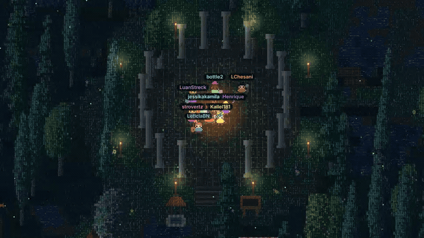
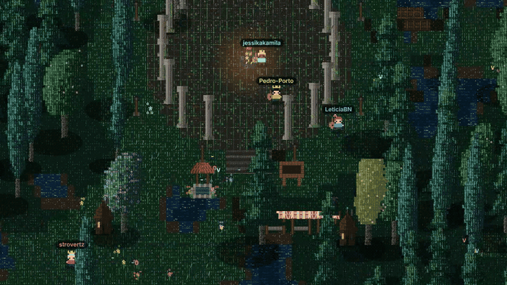
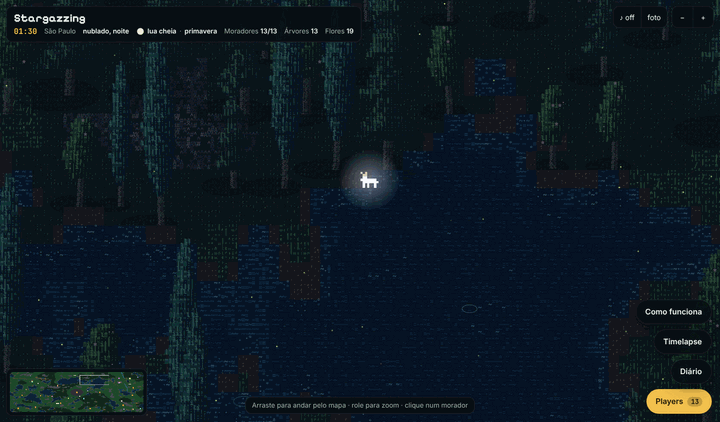
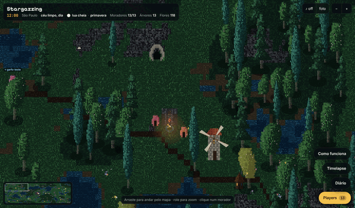
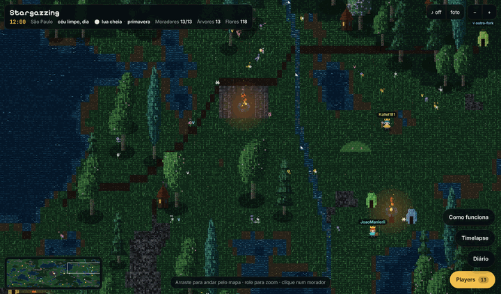
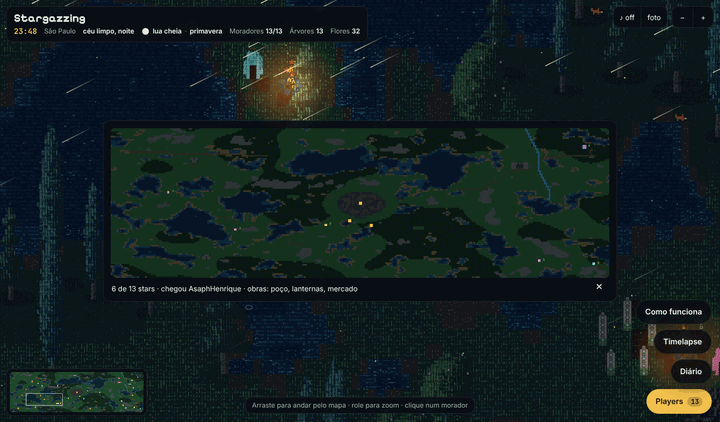

<div align="center">



# Stargazzing

**Uma floresta em pixel art que vive sozinha. Cada ⭐ neste repositório vira um morador.**

[**Abrir o mundo →**](https://strovertz.github.io/stargazzing/) &nbsp;·&nbsp; [Dar uma star e virar morador](https://github.com/strovertz/stargazzing/stargazers) &nbsp;·&nbsp; [English](#english)



</div>

## O que é

Você dá uma star e, em poucos minutos, um personagem com o seu login chega pela borda do mapa, constrói uma cabana, planta uma árvore e passa a viver ali. Ele pesca, rega a árvore, visita os amigos, conversa com quem cruza no caminho e, à noite, faz roda na fogueira.

Não há servidor nem IA rodando a simulação. O mundo é uma função pura:

```
mundo = f(semente, stargazers, dados do repo, hora atual)
```

Por isso ele continua vivo sem ninguém olhando, e quem abre o site no mesmo instante vê exatamente a mesma cena.

<div align="center">

</div>

## Seu cartão para o README

Cada morador ganha um cartão SVG animado, gerado a cada deploy. Troque `SEU-LOGIN` pelo seu login, em minúsculas:

```markdown
[](https://strovertz.github.io/stargazzing/?u=SEU-LOGIN)
```



A vila inteira também tem o seu, sempre com o número atualizado de moradores:

```markdown
[](https://strovertz.github.io/stargazzing/)
```

No site, o botão **Cartão p/ README** no card de cada morador já copia o markdown pronto.

## O que acontece por lá

| | |
| --- | --- |
| **Moradores** | O hash do login define aparência, chapéu, espécie da árvore, ritmo, temperamento e profissão: lenhador, pescador, músico, jardineiro, explorador ou minerador. Um em cada quatro é coruja e fica na fogueira até tarde. |
| **Relações** | A afinidade entre dois logins decide quem é amigo (sempre para para conversar e se visita), quem não se bica (desvia e resmunga) e quem forma casal e vai morar ao lado. |
| **Envelhecimento** | Com 7 dias de vila o cabelo fica grisalho, com 30 alguns ganham barba e com 60 o cabelo fica branco. Árvores antigas ficam enormes. |
| **Vila que cresce** | Poço, lanternas, mercado, píer, jardim e estátua surgem conforme chegam stars, e a cada 2 stars uma coluna da ágora é restaurada. Toda quarta às 19h o conselho vota a ordem das próximas obras. |
| **Clima e calendário** | Sol, nuvens, neblina, garoa, chuva e tempestade com relâmpagos, sobre o horário real de São Paulo. Estações pela data (hemisfério sul), lua na fase de verdade, feira no fim de semana e corrida de vaga-lumes na sexta. |
| **Natureza** | Coelhos e raposas seguem um modelo predador-presa dia a dia. Trilhas esquecidas viram flores. Um riacho desce até o lago com folhas e barquinhos de papel. |
| **Lendas** | Em noite de lua cheia aparece o cervo branco. Com 25 stars a mata revela um templo escondido, e com 50 o cristal dele acende. |
| **Mutirão** | Na tempestade, um raio pode acertar uma árvore. Os vizinhos correm com baldes, apagam o fogo e replantam uma muda no lugar. |

<table>
<tr>
<td><br><sub>O cervo branco, só na lua cheia</sub></td>
<td><br><sub>Caverna dos mineradores e o moinho</sub></td>
</tr>
<tr>
<td><br><sub>Riacho e o morro onde o templo dorme</sub></td>
<td><br><sub>Timelapse: a vila nascendo star por star</sub></td>
</tr>
</table>

## O GitHub vira mundo

A cada deploy o site lê dados públicos do repositório:

| No GitHub | Na floresta |
| --- | --- |
| ⭐ Star | Um morador novo chega pela borda |
| 🍴 Fork | Um acampamento com o seu nome numa das bordas, com trilha até a ágora |
| 📌 Issue com a label `pedido` | Um papel no quadro da ágora; quando a issue fecha, a vila faz festa com confete |
| 🛠️ Commits recentes | O céu abre. Uma semana sem commits traz neblina |
| 👤 Seguidores do autor | Um por dia passa como mercador, com carroça, das 9h às 17h |

Quer pedir algo para a vila? [Abra uma issue](https://github.com/strovertz/stargazzing/issues/new) com a label `pedido`.

## Como brincar

| Ação | O que faz |
| --- | --- |
| Arrastar / rolar | Anda pelo mapa / zoom |
| Clicar num morador | Abre o card, com bio, amigos e rivais; a câmera segue |
| `?u=login` na URL | Abre o site seguindo esse morador ([exemplo](https://strovertz.github.io/stargazzing/?u=strovertz)) |
| Botão **foto** | Baixa um PNG da cena, sem a interface, com legenda |
| Botão **Timelapse** | Mostra a vila nascendo, star por star |
| Botão **♪** | Som ambiente sintetizado: vento, chuva, grilos, fogueira e um alaúde que toca a melodia da noite (a mesma para todo mundo) |
| Tecla `L` | Solta uma lanterna de papel no céu |
| ↑ ↑ ↓ ↓ ← → ← → B A | 🤫 |

## Como funciona por dentro

| Peça | Técnica | Efeito |
| --- | --- | --- |
| Identidade | FNV-1a(login) → mulberry32 | Mesmo login, mesmo personagem, em qualquer navegador |
| Terreno | Ruído Perlin + lagos | Água, areia, grama, mata, pedra, riacho e ruínas |
| Comportamento | Máquina de estados com pesos | Pesos por temperamento, profissão, hora e clima |
| Rastro | Formiga de Langton | Passos gastam a grama em trilha |
| Grupos | Boids | Rodas de fogueira e passeios na ágora |
| Caminhos | A* octil com heap binário | Casa, vizinhos, marcos, caverna, fogo |
| Clima | Perlin 3D sobre o tempo real | Frentes de nuvem, pancadas, neblina, vento |
| Bichos | Lotka-Volterra discreto | Coelhos e raposas que sobem e descem com as estações |

O relógio anda em ticks de 0,5 s. Ao abrir, o site parte da meia-noite local e refaz o dia até agora, o que leva menos de um segundo. O render é em "mini-grade": cada célula vira 12 caracteres miúdos, o chão é rasterizado em blocos cacheados por zoom e a escuridão é uma camada em 1/4 da resolução, com furos de luz.

## Rodando localmente

Requer Node 22.

```bash
npm ci
npm run dev        # servidor local em http://localhost:5173
npm test           # testes de determinismo e dos sistemas
npm run build      # typecheck + build em dist/ (inclui os cartões SVG)
```

Para testar com dados do GitHub localmente, rode `node scripts/fetch-repo-data.mjs dono/repo` com `GITHUB_TOKEN` definido. O script grava `public/repo.json`, que não vai para o git.

```
src/core/     PRNG, hash, ruído Perlin, cores
src/sim/      simulação pura, sem DOM: roda igual no navegador e no Node
src/render/   canvas: chão, árvores, construções, bichos, luz e clima
src/cards/    cartões SVG animados (gerados no build)
src/ui/       timelapse
src/audio/    som ambiente com Web Audio
scripts/      stargazers, perfis e dados do repo
tests/        determinismo, identidade, desempenho e sistemas novos
```

## Fazendo o seu

1. Faça um fork e ative o GitHub Pages com a fonte **GitHub Actions**.
2. Crie o secret `STARS_TOKEN` com um token pessoal só de leitura. Ele busca a lista de stargazers e os perfis; sem ele, o deploy usa o `public/world.json` versionado.
3. Crie a label `pedido` para usar o quadro da ágora.
4. Troque `seed` e `repo` em `public/world.json`, e o endereço em `SITE` no `vite.config.ts`.

Cada star nova dispara o deploy pelo evento `watch` e entra no `world.json` na hora. Um cron a cada 30 minutos cobre o resto.

## Segurança

- Actions fixadas por SHA, com `permissions` mínimas e Dependabot.
- Content Security Policy no build: só scripts do próprio site.
- Logins e títulos de issues são desenhados no canvas ou inseridos via `textContent`, nunca como HTML. No SVG, o texto é escapado e o login é validado.
- O `repo.json` é validado campo a campo antes de entrar na simulação.

---

## English

**Stargazzing** is a self-running pixel-art forest where every GitHub star becomes a villager. Each villager builds a hut, plants a tree, fishes, chats with friends and joins the campfire at night. The whole world is a pure function of a seed, the stargazer list, repo data and the current time: no server and no AI, and everyone sees the same scene.

- ⭐ **Stars** become villagers, 🍴 **forks** become camps at the map edge, 📌 **issues labeled `pedido`** are pinned to the agora board (the village throws a party when one closes), 🛠️ **commits** clear the sky, and the author's **followers** visit as merchants.
- The village keeps growing: friendships and rivalries, couples living side by side, aging, a weekly council, a predator-prey ecosystem, lightning fires put out by bucket brigades, a white stag on full-moon nights and a hidden temple unlocked at 25 stars.
- Get your own animated README card at `https://strovertz.github.io/stargazzing/cards/<your-login>.svg`.

[**Open the world →**](https://strovertz.github.io/stargazzing/)
